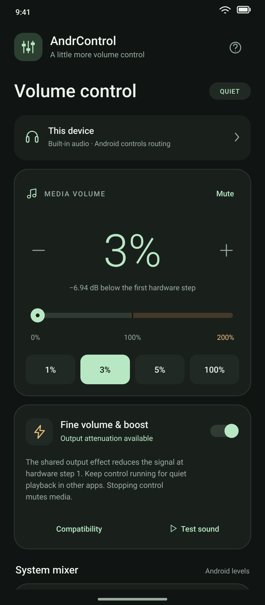

# AndrControl

A native Android volume controller inspired by pavucontrol. Set media volume from **0 to 200%**, including software attenuation **below the first hardware step** on supported outputs. Android 9 or newer; no root, account, ads, or network permission.

<p align="center">
  
  <br />
  <sub>Simulated v1.1 interface with example values.</sub>
</p>

## Use

1. Install the debug APK or open this project in Android Studio and run it.
2. Adjust media volume. Tap the large percentage to type a value.
3. For quieter playback below Android's first step, choose **1%**, **3%**, or **5%**. This starts **Fine volume & boost** and requests a negative signal gain. On a 15-step phone, these values keep hardware step 1 and reduce its signal rather than rounding to mute or 7%.
4. In Automatic compatibility mode, quiet playback requires a supported shared output effect. If it is unavailable, the app keeps media muted and explains why. **QUIET** means an enabled attenuation handle and a nonzero hardware step; it is not an acoustic measurement or proof that every vendor audio path traverses the effect.
5. Use **Test sound** to check the effect with a quiet, four-second chime on a known audio session.
6. Keep precise control running while you use other apps. The notification offers **Mute** and **Stop control**. Stopping while using quiet playback mutes media before releasing the attenuator, preventing a jump to the louder first step.

Ringtone, notification, and alarm controls are separate 0–100% sliders. Some devices link ringtone and notification volume. Tap the output card to open Android sound settings.

## How fine volume works

Android normally exposes only a fixed number of media-volume steps. On a 15-step device, step 1 is displayed as approximately 7%, and changing the requested integer percentage alone cannot produce anything quieter.

Version 1.1 adds `DynamicsProcessing` with EQ, compression, and limiter stages disabled. Values below the first audible step use a uniform negative input gain at hardware step 1:

| Request on a 15-step phone | Signal relative to hardware step 1 | Attenuation |
| --- | --- | --- |
| 1% | 15% | −16.48 dB |
| 2% | 30% | −10.46 dB |
| 3% | 45% | −6.94 dB |
| 5% | 75% | −2.50 dB |
| 6% | 90% | −0.92 dB |

The first-step fraction is calculated from the device's actual step count. The effect is configured before hardware is unmuted. While it starts, while unavailable, or if control of it is lost, quiet requests stay muted. The percentage is a signal-level target relative to that first step, not a measured percentage of maximum speaker loudness.

## Android audio support

Android does not expose PulseAudio/PipeWire's unrestricted per-app mixer to ordinary apps. This app uses the public APIs and reports their limitations:

- **0%:** mutes media. **Below the first audible hardware step:** uses negative signal gain as described above. **Other values up to 100%:** select Android's normal hardware steps; the applied hardware percentage is shown when it differs from the request.
- **100–200%:** `LoudnessEnhancer` requests additional signal gain. Gain is `2000 × log10(percent / 100)` millibels, so 200% targets +6.02 dB, twice the signal amplitude. Its compressor limits peaks; this does not promise twice the perceived loudness.
- **Automatic compatibility:** tries shared output effects (session 0), using `DynamicsProcessing` for attenuation and `LoudnessEnhancer` for boost. If shared attenuation fails, quiet playback stays muted. Positive boost may fall back to sessions announced through Android's `OPEN_AUDIO_EFFECT_CONTROL_SESSION` broadcasts or a player's audio-effects panel. Shared and per-player effects of the same type are never stacked by this app; attenuation and positive boost are not active together.
- **Player sessions only:** available in **Compatibility** when a device accepts a shared effect but does not actually process the desired output. Restart playback to announce an existing session, or choose AndrControl from the player's audio-effects panel.
- Some players do not announce sessions, and protected playback, audio offload, calls, or particular Bluetooth/device audio paths may bypass effects. Shared effects are deprecated in Android. A successfully created effect does not prove every app's audio traverses it; check your own speaker playback after enabling quiet control.
- Ringtone, notifications, and alarms are not amplified by the per-player backend. A legacy shared effect may also process other audio mixed into the same output; its exact scope is device-dependent. AndrControl does not offer arbitrary independent per-app attenuation or microphone controls.

Precise audio control uses a user-started `specialUse` foreground service with a persistent notification. It continues while you use other apps. Stopping while attenuated mutes before releasing all effects. It does not auto-start at boot or restore effects after process death. Android can remove effects if it kills the process, so quiet playback depends on keeping this service running. Normal volume changes remain Android system settings. Hardware volume changes outside AndrControl return to Android's normal steps and remove the fine reduction.

The app neither records audio nor captures the screen. The only runtime permission request is for notifications on Android 13+. A denied notification permission does not prevent Android from running a foreground service; its controls may instead appear in Android's Active apps screen.

Boost can add distortion. Begin with a low volume and use the test sound before increasing it.

## Build

Requires JDK 17+ (JDK 21 works), Android SDK platform 36, and Build Tools 36.0.0. Gradle 9.1.0 and Android Gradle Plugin 9.0.1 are pinned. The app uses native Android views and the Kotlin support built into AGP, with no third-party runtime dependencies.

Set the SDK path in an untracked `local.properties`:

```properties
sdk.dir=/path/to/Android/Sdk
```

Then run:

```sh
./gradlew assembleDebug testDebugUnitTest lintDebug
```

APK: `app/build/outputs/apk/debug/app-debug.apk`

Install on a connected phone with USB debugging enabled:

```sh
adb install -r app/build/outputs/apk/debug/app-debug.apk
```

The debug APK is for local installation. A distributable release needs your own signing configuration.

## Verification

Nine unit tests cover hardware volume mapping, the 1–6% floor regression, negative-gain conversion, device step counts and minimums, rounding, clamping, zero-step devices, and monotonicity. Android lint checks the application and manifest.

Device tests cover media control, mute/unmute, foreground service startup, positive gain, attenuation below the first hardware step, hardware volume changes, and background service behavior. The quiet-only runner verifies negative gain and mute-before-stop. Acoustic loudness is not measured by the runner.

To repeat the device checks, stop boost first, connect an unlocked phone with USB debugging authorized, and run:

```sh
./gradlew assembleDebug assembleDebugAndroidTest
adb install -r app/build/outputs/apk/debug/app-debug.apk
adb install -r app/build/outputs/apk/androidTest/debug/app-debug-androidTest.apk
adb shell am instrument -w -r -e quiet true dev.andrcontrol.test/dev.andrcontrol.DeviceSmokeInstrumentation
adb uninstall dev.andrcontrol.test
```

The quiet-only runner checks every value from 1% through 6%, verifies step 1 with attenuation, and checks mute-before-stop. It restores the original hardware media volume and compatibility preference. It operates on AndrControl's own views and does not change notification permission or USB security settings. Look for `passed=true` and `INSTRUMENTATION_CODE: -1`. Omit `-e quiet true` to run the older full-range boost checks, which temporarily select higher hardware levels.

For a physical-device check:

1. Choose 1%, 3%, and 5%. Confirm the status is **QUIET** and a negative dB value is displayed. The system volume may still display 7%; the software reduction is additional.
2. Compare **Test sound** at these values. Then check speaker playback in your own apps. Shared-effect bypass is a device/audio-path limitation.
3. Leave AndrControl and confirm quiet playback continues. Stop control and confirm media mutes rather than jumping louder.
4. Check mute/unmute, compatibility changes, hardware volume changes, headset routing, Do Not Disturb, and linked ringtone/notification behavior as appropriate.

Reference: [DynamicsProcessing](https://developer.android.com/reference/android/media/audiofx/DynamicsProcessing), [Android AudioEffect](https://developer.android.com/reference/android/media/audiofx/AudioEffect), [LoudnessEnhancer](https://developer.android.com/reference/android/media/audiofx/LoudnessEnhancer), [AudioManager](https://developer.android.com/reference/android/media/AudioManager), and [foreground service types](https://developer.android.com/develop/background-work/services/fgs/service-types).
